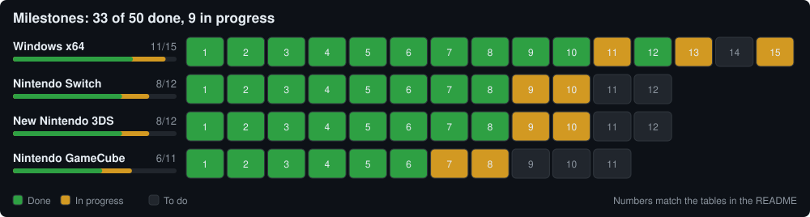
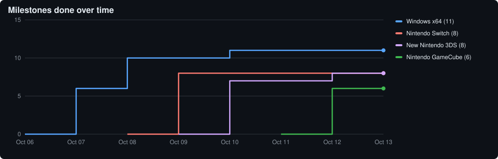

<div align="center">

# N.O.V.A. 3 — Decomp Port

**Gameloft's N.O.V.A. 3 (Android 1.0.1d), statically recompiled and running natively on PC and consoles.**<br>
No emulator, no JIT: the game's ARM code is translated to C ahead of time and runs on a small runtime that stands in for Android.

[](#windows-x64)
[](#nintendo-switch)
[](#new-nintendo-3ds)
[](#nintendo-gamecube)
[](LICENSE)

[Documentation](docs/README.md) · [Status](#status) · [Ports and branches](#ports-and-branches) · [Building](#building) · [Open issues](docs/open-issues.md)

</div>

> [!IMPORTANT]
> This repository contains **no game code or assets**. You need your own copy of N.O.V.A. 3
> 1.0.1d (the APK and its OBB files). The game, its library and everything generated from them
> (translated code, packaged builds, `.nsp` / `.cia` / disc images, texture packs) are Gameloft's
> and must not be redistributed.

## How it works

```
 libGloftNAHM.so (ARMv7, from your APK)
        │
        ├── recomp/arm2c.py ──► ~300 MB of C ──► x86-64 / AArch64 / PowerPC   (Windows, Linux, Switch, GameCube)
        │
        └── tools/v6patch.py ─► patched ARM code, run natively                (New 3DS: its CPU is ARM itself)
                                     │
               runtime/  the Android stand-in: guest memory, ELF loader, 426 imports (libc, pthreads,
                         GLES2), fake JNI / Java VM, files, sockets, C++ exceptions, setjmp
               host/     the platform side: window, launcher, input, audio, save folder, hooks into
                         game functions for controls, fixes and the offline cleanup
               backends  GLES2 on ANGLE / Mesa · PICA200 (citro3d) on 3DS · GX on GameCube
```

1. **Static recompilation**: `recomp/arm2c.py` translates every ARM and Thumb function in the
   game's library into C, verified instruction by instruction against Unicorn.
2. **Runtime**: `runtime/` replaces Android: memory, the imported libc / pthread / GLES2
   functions, a fake Java VM for the game's JNI calls, files and sockets.
3. **Host**: `host/` is the platform side, plus `OVERRIDES` hooks that replace or wrap game
   functions (controls, high-frame-rate fixes, the removal of the dead online services).

Over time, translated functions are replaced with readable C++ through the same hook mechanism.

## Status

[](docs/status/progress.svg)

[](docs/status/history.svg)

<sub>Each panel is one port: its areas (code, runtime, graphics, input, ...) sized by their number of features, one cell per feature. The percentage counts features done, checked in a run; amber cells are in progress. Generated by [`tools/status.py`](tools/status.py) from [`docs/status/milestones.json`](docs/status/milestones.json); open an image on its own to see each cell's name.</sub>

<!-- status:begin (tools/status.py) -->
<details>
<summary><b>Windows x64</b>: 79.6% (39/49 done, 6 in progress). Playable: campaign and local Wi-Fi matches, 240 fps, launcher; HD textures in progress.</summary>

Branch [`port/windows`](../../tree/port/windows) · details in [app-and-settings.md](docs/app-and-settings.md)

| Area | Feature | Status | Date |
|---|---|---|---|
| Code | ARM to C translation of every function | ✅ Done | 2026-10-07 |
| Code | Thumb | ✅ Done | 2026-10-07 |
| Code | Differential tests against Unicorn | ✅ Done | 2026-10-07 |
| Code | Register and flag flow analysis | ✅ Done | 2026-10-10 |
| Code | Inlined division helpers and imports | ✅ Done | 2026-10-10 |
| Code | Native hot paths | ✅ Done | 2026-10-09 |
| Code | Profile-guided optimisation | ✅ Done | 2026-10-10 |
| Code | Translated functions replaced with readable C++ | 🟡 In progress |  |
| Runtime | ELF loader, relocations, import slots | ✅ Done | 2026-10-07 |
| Runtime | Guest heap | ✅ Done | 2026-10-07 |
| Runtime | pthreads, semaphores, errno | ✅ Done | 2026-10-07 |
| Runtime | libc: strings, stdio, files, libm, time | ✅ Done | 2026-10-07 |
| Runtime | setjmp / longjmp | ✅ Done | 2026-10-07 |
| Runtime | C++ exceptions | ✅ Done | 2026-10-07 |
| Runtime | Fake JNI and Java classes | ✅ Done | 2026-10-07 |
| Runtime | Symbolized crash reports | ✅ Done | 2026-10-08 |
| Graphics | GLES2 on ANGLE | ✅ Done | 2026-10-07 |
| Graphics | Native resolution and display modes | ✅ Done | 2026-10-07 |
| Graphics | VSync and frame limiter | ✅ Done | 2026-10-07 |
| Graphics | Field of view | ✅ Done | 2026-10-08 |
| Graphics | HD texture pack (work in progress) | 🟡 In progress | 2026-10-08 |
| Audio | Vox AudioTrack on SDL3 | ✅ Done | 2026-10-07 |
| Audio | Click and drop-out fixes | ✅ Done | 2026-10-09 |
| Input | Keyboard and mouse gameplay | ✅ Done | 2026-10-08 |
| Input | Menus without touch | ✅ Done | 2026-10-08 |
| Input | Gamepad mapping | ✅ Done | 2026-10-08 |
| Input | Rebinding (first control per device shown) | 🟡 In progress | 2026-10-08 |
| Input | Physical gamepad (played on Switch hardware) | ✅ Done | 2026-10-21 |
| Input | Grenade, melee and interact keys tested | ⬜ To do |  |
| Game | Loading screens | ✅ Done | 2026-10-08 |
| Game | Tutorials and QTEs | ✅ Done | 2026-10-08 |
| Game | Slow motion at high frame rates | ✅ Done | 2026-10-08 |
| Game | Cutscene skip | ✅ Done | 2026-10-08 |
| Game | Jeep ride at high frame rates | ✅ Done | 2026-10-09 |
| Game | Section loads (other levels by replay only) | 🟡 In progress | 2026-10-09 |
| Game | Campaign's ten chapters toured | ✅ Done | 2026-10-09 |
| Game | Move QTEs, jeep, mech, iron-sight tutorials | ⬜ To do |  |
| Game | End-of-match and end-of-mission screens | ⬜ To do |  |
| Game | Uncapped frame rates in play | ⬜ To do |  |
| Online | Store, ads, social, logins removed | ✅ Done | 2026-10-08 |
| Online | Local Wi-Fi multiplayer | ✅ Done | 2026-10-08 |
| Online | Peer addresses (ZeroTier) | ✅ Done | 2026-10-10 |
| Online | Discord Rich Presence | ✅ Done | 2026-10-08 |
| App | Launcher | ✅ Done | 2026-10-07 |
| App | nova3.ini | ✅ Done | 2026-10-07 |
| App | Saves in Saved Games | ✅ Done | 2026-10-08 |
| App | Packaged copy (tools/package.py) | ✅ Done | 2026-10-08 |
| App | Migration on a real install | 🟡 In progress |  |
| App | Linux build (tested once in WSL) | 🟡 In progress | 2026-10-07 |

</details>

<details>
<summary><b>Nintendo Switch</b>: 80.0% (24/30 done, 3 in progress). Homebrew .nsp / .nro: whole campaign and local matches in emulators, 52-56 fps on hardware.</summary>

Branch [`port/switch`](../../tree/port/switch) · details in [switch.md](docs/switch.md)

| Area | Feature | Status | Date |
|---|---|---|---|
| Build | devkitPro CMake build | ✅ Done | 2026-10-09 |
| Build | Translated code at -fPIE | ✅ Done | 2026-10-10 |
| Build | .nro for the homebrew menu | ✅ Done | 2026-10-09 |
| Build | Installable .nsp | ✅ Done | 2026-10-09 |
| System | 4 GB guest via svcMapPhysicalMemory | ✅ Done | 2026-10-09 |
| System | Heap split for Mesa and stacks | ✅ Done | 2026-10-09 |
| System | In-process pipes for boost::asio | ✅ Done | 2026-10-09 |
| System | Exit through svcExitProcess | ✅ Done | 2026-10-09 |
| System | Physics-thread race fixed | ✅ Done | 2026-10-09 |
| System | Thread-stack leak fixed | ✅ Done | 2026-10-09 |
| System | Heap flat over a long session | 🟡 In progress |  |
| Graphics | GLES2 on Mesa nouveau | ✅ Done | 2026-10-09 |
| Graphics | GL call filtering | ✅ Done | 2026-10-09 |
| Graphics | Shader pool and prewarm | ✅ Done | 2026-10-09 |
| Audio | SDL2 audio queue | ✅ Done | 2026-10-09 |
| Audio | Redesign after hardware drop-outs | ✅ Done | 2026-10-09 |
| Input | Controller buttons and sticks | ✅ Done | 2026-10-09 |
| Input | Gyro aiming | ✅ Done | 2026-10-09 |
| Input | Rumble | ✅ Done | 2026-10-09 |
| Input | A/B swap and Switch button names | ✅ Done | 2026-10-09 |
| Input | libnx controller reading on hardware | ✅ Done | 2026-10-21 |
| Input | Touchscreen | ⬜ To do |  |
| Input | System keyboard (Player IP) | 🟡 In progress | 2026-10-09 |
| Game | Ten chapters in Ryujinx / Citron | ✅ Done | 2026-10-09 |
| Game | Seven multiplayer maps hosted | ✅ Done | 2026-10-09 |
| Game | Offline cleanup and section-load fixes played | ⬜ To do |  |
| Hardware | Runs on a console | ✅ Done | 2026-10-09 |
| Hardware | Loading: read cache, CPU boost, file-table lock | ✅ Done | 2026-10-09 |
| Hardware | Steady 60 fps (52-56 measured) | 🟡 In progress | 2026-10-10 |
| Hardware | Multiplayer between two consoles | ⬜ To do |  |

</details>

<details>
<summary><b>New Nintendo 3DS</b>: 73.7% (28/38 done, 6 in progress). The game&#x27;s own ARM code runs natively; boots and plays on a New 3DS at about 26 fps.</summary>

Branch [`port/3ds`](../../tree/port/3ds) · details in [3ds.md](docs/3ds.md)

| Area | Feature | Status | Date |
|---|---|---|---|
| Code | Instruction census | ✅ Done | 2026-10-10 |
| Code | ARMv6K patch set (143,859 sites) | ✅ Done | 2026-10-10 |
| Code | Native so-loader | ✅ Done | 2026-10-10 |
| Code | Assembly gates into the runtime | ✅ Done | 2026-10-10 |
| Code | Hook table (137 hooks) | ✅ Done | 2026-10-10 |
| Code | Kernel helper fixups | ✅ Done | 2026-10-10 |
| Code | Hot imports without the gate | ✅ Done | 2026-10-10 |
| Memory | Layout in 178 MB | ✅ Done | 2026-10-10 |
| Memory | Guest heap apart from the host's | ✅ Done | 2026-10-10 |
| Memory | Title-menu hang (pthread_join) fixed | ✅ Done | 2026-10-10 |
| Graphics | PICA200 backend over citro3d | ✅ Done | 2026-10-10 |
| Graphics | Materials without fragment shaders | ✅ Done | 2026-10-10 |
| Graphics | GL replay verification | ✅ Done | 2026-10-10 |
| Graphics | Menus at 400x240 | ✅ Done | 2026-10-10 |
| Graphics | Bottom-screen menus with touch | ✅ Done | 2026-10-10 |
| Graphics | Fresh index numbers (console GPU) | ✅ Done | 2026-10-12 |
| Graphics | Depth fighting (float24) on the console | 🟡 In progress | 2026-10-12 |
| Graphics | Cheaper per-draw index rewrite | ⬜ To do |  |
| Audio | ndsp with the console's DSP firmware | ✅ Done | 2026-10-10 |
| Audio | CSND fallback | ✅ Done | 2026-10-10 |
| Audio | 80 ms sound queue on the console | 🟡 In progress | 2026-10-12 |
| Input | Buttons, Circle Pad, C-Stick | ✅ Done | 2026-10-10 |
| Input | Controls page | 🟡 In progress | 2026-10-12 |
| Input | Easier campaign and aim snap | 🟡 In progress | 2026-10-12 |
| Files | Slim data | ✅ Done | 2026-10-10 |
| Files | Packed archives | ✅ Done | 2026-10-10 |
| Files | Loads 4x faster | ✅ Done | 2026-10-10 |
| Files | .cia and SD card image | ✅ Done | 2026-10-12 |
| Game | Title menu at 30 fps (Azahar) | ✅ Done | 2026-10-10 |
| Game | Campaign chapters near 30 fps (Azahar) | ✅ Done | 2026-10-10 |
| Game | Local match hosted (Azahar) | ✅ Done | 2026-10-10 |
| Game | Level end and match end | ⬜ To do |  |
| Game | Multiplayer between consoles | ⬜ To do |  |
| Hardware | Boots on a New 3DS | ✅ Done | 2026-10-12 |
| Hardware | Plays at about 26 fps | ✅ Done | 2026-10-12 |
| Hardware | 24-30 fps, no dips below 24 | 🟡 In progress | 2026-10-12 |
| Hardware | HOME Menu suspend | 🟡 In progress | 2026-10-12 |
| Hardware | No pause when changing weapons | ⬜ To do |  |

</details>

<details>
<summary><b>Nintendo GameCube</b>: 61.5% (16/26 done, 4 in progress). 24 MB and one core: demand paging to ARAM and disc; the title menu runs in Dolphin.</summary>

Branch [`port/gamecube`](../../tree/port/gamecube) · details in [gamecube.md](docs/gamecube.md)

| Area | Feature | Status | Date |
|---|---|---|---|
| Toolchain | devkitPPC and patched libogc2 | ✅ Done | 2026-10-12 |
| Toolchain | libdvm (SD card) | ✅ Done | 2026-10-12 |
| Toolchain | Dolphin harness and GDB | ✅ Done | 2026-10-12 |
| Memory | Pager: page table, DSI / ISI | ✅ Done | 2026-10-12 |
| Memory | ARAM tier | ✅ Done | 2026-10-12 |
| Memory | Page compression | ✅ Done | 2026-10-12 |
| Memory | Disc tier | ⬜ To do |  |
| Memory | Frame pinning for DMA | ⬜ To do |  |
| Code | Big-endian runtime | ✅ Done | 2026-10-12 |
| Code | Translated code for the Gekko | ✅ Done | 2026-10-12 |
| Code | Paged code file | ✅ Done | 2026-10-12 |
| Code | Function ordering | ✅ Done | 2026-10-12 |
| Files | Disc image tool | ✅ Done | 2026-10-12 |
| Files | DVD file system | ✅ Done | 2026-10-12 |
| Files | SD card build for Swiss | 🟡 In progress | 2026-10-12 |
| Graphics | GX backend | ✅ Done | 2026-10-12 |
| Graphics | Render-target compositing | ✅ Done | 2026-10-12 |
| Graphics | Every material | 🟡 In progress | 2026-10-12 |
| Graphics | 480p | ⬜ To do |  |
| Platform | Threads, clocks, watchdog | ✅ Done | 2026-10-12 |
| Platform | Controller in the menus | 🟡 In progress | 2026-10-12 |
| Platform | Audio over the AI DMA | 🟡 In progress | 2026-10-12 |
| Game | Title menu in Dolphin | ✅ Done | 2026-10-12 |
| Game | A campaign level | ⬜ To do |  |
| Hardware | First console test | ⬜ To do |  |
| Hardware | Measurement and optimisation | ⬜ To do |  |

</details>

<!-- status:end -->

## Ports and branches

`main` holds the shared code: every port builds from the same recompiler, runtime and host
modules, with a small platform layer each. Each port has its own branch for its work in
progress, merged back into `main` when it is ready.

| Port | Branch | How the game runs | Output | Guide |
|---|---|---|---|---|
| <a id="windows-x64"></a>**Windows x64** (Linux builds too) | [`port/windows`](../../tree/port/windows) | translated C, clang-cl, SDL3, ANGLE | `nova3.exe` + launcher | [App and settings](docs/app-and-settings.md) |
| <a id="nintendo-switch"></a>**Nintendo Switch** | [`port/switch`](../../tree/port/switch) | translated C, devkitA64, SDL2, Mesa | `.nsp` / `.nro` homebrew | [Switch](docs/switch.md) |
| <a id="new-nintendo-3ds"></a>**New Nintendo 3DS** | [`port/3ds`](../../tree/port/3ds) | the original ARM code, patched for ARMv6K | `.cia` / SD card image | [3DS](docs/3ds.md) |
| <a id="nintendo-gamecube"></a>**Nintendo GameCube** | [`port/gamecube`](../../tree/port/gamecube) | translated C for the Gekko, demand-paged to ARAM | `.dol` + disc / SD card | [GameCube](docs/gamecube.md) |

## Features (PC)

- Keyboard / mouse and gamepad instead of touch, rebindable; menus driven without touch.
- Native resolution, display modes, VSync, frame limiter, field of view, up to 240 fps tested,
  with fixes for the timers and physics that break at high frame rates.
- A launcher and `nova3.ini`; saves in *Saved Games*.
- An offline game: store, ads, social networks and logins removed; local Wi-Fi multiplayer
  kept (also over ZeroTier-style networks through peer addresses).
- Optional HD texture pack (work in progress).

## Building

### Windows

Needs Python 3, the MSVC build tools with clang-cl, CMake and Ninja. Your APK and OBBs go in
`game/` (ignored by git).

```bat
python -c "import zipfile; open('game/libGloftNAHM.so','wb').write(zipfile.ZipFile('NOVA-3-v1-0-1d.apk').read('lib/armeabi-v7a/libGloftNAHM.so'))"
python recomp\arm2c.py gen build\gen                 :: whole binary (~15 s, ~300 MB of C)
python recomp\arm2c.py gen build\gen_x DECODE_XOR32  :: one function + its callees
ninja.cmd build\cmake_full nova3                    :: incremental: only changed files rebuild
build\cmake_full\nova3.exe                         :: launcher, then the game (finds the game folder itself)
build\cmake_full\nova3.exe -silent                 :: straight into the game with the saved settings
python tools\package.py                             :: dist\: nova3.exe + DLLs + nova3_data\ (the .so + the OBBs' contents)
dist\nova3.exe                                     :: the packaged copy (each build refreshes its nova3.exe)
:: options: -silent  --user DIR (saves + settings, default "Saved Games/N.O.V.A. 3")  --config FILE
::          --frames N (-1 = forever)  --size WxH (windowed)
::          --headless 1  --screenshot FRAME:file.png
::          --probe addr[/r0/r1/r2/r3],...  --obb DIR  --apk FILE  --data DIR
:: scripted input (repeatable; the window then never takes focus and real input is ignored):
::   --tap FRAME:X,Y  --drag FRAME:X1,Y1,X2,Y2,N  --type FRAME:text
::   --hold FRAME:KEY,N (KEY: a binding name: W, Space, Mouse1, Escape, ...)  --look FRAME:DX,DY
:: debug: --peek FRAME:LINKADDR  --trace-events 1  --dump-hud FRAME  --launcher-shot FILE.png
python tools\obb.py list  <main.obb> <patch.obb>
python tools\obb.py extract out\ <main.obb> <patch.obb>
```

### Linux

Tested once on Ubuntu 24.04 in WSL; development and testing happen on Windows. Needs clang,
CMake, Ninja and SDL3 (24.04 has no SDL3 package, so build release-3.4.18 from source with the
X11 / Wayland / EGL / audio `-dev` packages installed). The generated files are large, so limit
parallel jobs to the available memory (`-j4` fits in 15 GB):

```sh
cmake -S . -B build-linux -G Ninja -DCMAKE_BUILD_TYPE=Release -DCMAKE_C_COMPILER=clang -DCMAKE_CXX_COMPILER=clang++ -DCMAKE_PREFIX_PATH=$HOME/sdl3
ninja -C build-linux -j4
LD_LIBRARY_PATH=$HOME/sdl3/lib build-linux/nova3     # same options and data layout as on Windows
```

### Consoles

[Switch](docs/switch.md#building) (devkitPro, SDL2, Mesa; `.nsp` packed with your own keys),
[New 3DS](docs/3ds.md#building-and-running) (devkitARM, citro3d; `.cia` and an SD card image),
[GameCube](docs/gamecube.md#building-and-testing) (devkitPPC, libogc2; disc image or SD card for Swiss).

<details>
<summary><b>Source layout</b></summary>

| Path | What |
|---|---|
| `recomp/arm2c.py` | ARM → C static recompiler, `OVERRIDES` hook declarations |
| `runtime/recomp.h` | Contract between generated code and runtime (Cpu struct, memory, macros) |
| `runtime/runtime.cpp` | Address space, ELF loader, relocations, import slots, dispatch, crash reports |
| `runtime/heap.cpp`, `thread.cpp`, `libc_*.cpp`, `eh.cpp` | Guest heap, pthreads, libc, C++ exceptions |
| `runtime/jni.{h,cpp}`, `java.cpp` | Fake Java VM and the Java classes the game calls |
| `runtime/gles.cpp`, `gl_program.cpp` | GLES2 imports; `gles_null.cpp` headless, `gles_pica.cpp` 3DS, `gles_gx.cpp` GameCube |
| `runtime/net.cpp` | BSD sockets for LAN multiplayer |
| `runtime/os.h`, `os_win.cpp`, `os_posix.cpp`, `os_switch.cpp`, `os_3ds.cpp`, `os_gc.cpp` | The runtime's only OS dependencies, one file per platform |
| `runtime/native_3ds*.{cpp,S}` | 3DS: native execution of the game's code, assembly gates into the runtime |
| `runtime/gc_*.c` | GameCube: the pager (MMU, ARAM, compression), DVD and RAM file systems |
| `host/main.cpp` | `nova3.exe`: SDL window, GLES context, Android lifecycle replay, frame loop |
| `host/switch/`, `host/3ds/`, `host/gc/` | Each console's entry point and platform glue |
| `host/input.cpp`, `controls_menu.cpp` | Input on every platform, the Controls page |
| `host/hooks.cpp`, `native_hot.cpp` | Hooks into game functions; native versions of hot functions |
| `host/settings.cpp`, `launcher.cpp` | `nova3.ini`, the Dear ImGui launcher |
| `host/audio.cpp` | `android.media.AudioTrack` emulated on SDL / ndsp |
| `host/offline.cpp` | The offline cleanup |
| `host/eventlog.cpp` | Event log, debug console, scripted test runs |
| `tools/` | ELF / OBB tools, disassembler, packaging (`package.py`, `switch_nsp.py`, `3ds_cia.py`, `gc_disc.py`), 3DS patch set and hook table, test drivers, `status.py` |
| `tests/` | Differential tests against Unicorn, 3DS and GameCube test programs |
| `extern/` | Dear ImGui 1.92.9b (MIT), SDL3 3.4.18 Windows package (zlib) |

</details>

## Documentation

Everything is documented in [`docs/`](docs/README.md): the [recompiler](docs/recompiler.md),
the [runtime](docs/runtime.md), [input](docs/input.md), [gameplay fixes](docs/gameplay-fixes.md),
[audio](docs/audio.md), the [offline game](docs/offline.md), [debugging](docs/debugging.md),
each port's guide, the [work history](docs/history/README.md) and the
[open issues](docs/open-issues.md).

## Disclaimer

This project is for interoperability, research and preservation. It does not include or
distribute Gameloft's or Nintendo's software, game assets, firmware or cryptographic keys;
console builds use the player's own keys and system files. Users are responsible for owning
the game and for using it in accordance with applicable laws and its license terms.
N.O.V.A. 3 is a trademark of Gameloft; this project is not affiliated with or endorsed by
Gameloft or Nintendo.

## License

The project's own code (recompiler, runtime, host, tools and documentation) is under the
[MIT License](LICENSE). Third-party code in `extern/` keeps its own license: Dear ImGui (MIT),
SDL (zlib). The license covers this repository only, not the game or anything generated from it.
